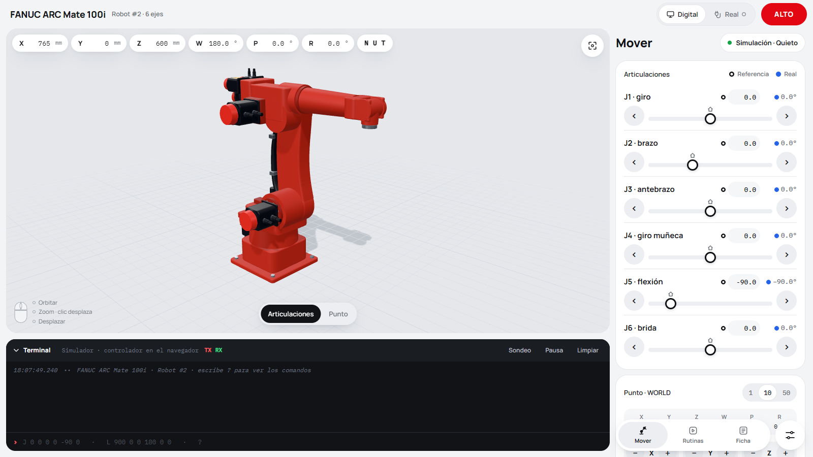

# fanuc-rehab

Rehabilitación de un robot industrial FANUC de 6 ejes (Robot #2, Formet), en colaboración con el Fab Lab de la Ibero Puebla.

**Gemelo digital:** https://sebas30073007.github.io/fanuc-rehab/

[](https://sebas30073007.github.io/fanuc-rehab/)

## El robot

- Probablemente un **FANUC ARC Mate 100i (≈ M-6i)**. Falta confirmarlo con la placa del robot.
- Motores: J1–J3 αM6/3000 (A06B-0162-B175), J4–J6 α1/3000 (A06B-0371-B175).
- Cinemática tomada del M-6iB (ROS-Industrial): a1 150, a2 600, a3 100, d4 615, d6 100 mm, con J2 a 450 mm del piso. Alcance de 1373 mm (el ARC Mate 100i publica 1368 mm).

## Contenido

| Carpeta | Qué hay |
|---|---|
| `software/gemelo/` | Gemelo digital web (three.js, sin dependencias de servidor) |
| `referencia/cad/` | Mallas y URDF del M-6iB (ROS-Industrial, BSD-3-Clause) y sus fuentes |
| `referencia/specs/` | Resumen técnico, datos de los motores α y enlaces a los manuales |

## Correr en local

```sh
cd software/gemelo
python -m http.server 8824
```

Luego abre http://127.0.0.1:8824/. La prueba de cinemática directa e inversa está en `software/gemelo/tools/prueba_cinematica.mjs` (`node tools/prueba_cinematica.mjs`).

## Estado

- [x] Gemelo digital: modelo 3D, cinemática directa e inversa, simulación
- [ ] Confirmar el modelo con la placa y los parámetros DH del controlador
- [ ] Diagnóstico de motores, amplificadores y controlador (RJ2/RJ3)
- [ ] Modo Real: enlace del gemelo con el controlador

## Licencias y avisos

- Código propio: MIT (ver `LICENSE`).
- Mallas y URDF del M-6iB: BSD-3-Clause, © TU Delft Robotics Institute / ROS-Industrial (`referencia/cad/ros-industrial-fanuc_m6ib_support/LICENSE`).
- three.js: MIT (`software/gemelo/vendor/three/LICENSE`).
- Proyecto independiente, sin relación con FANUC Corporation. FANUC y ARC Mate son marcas de sus respectivos dueños.
